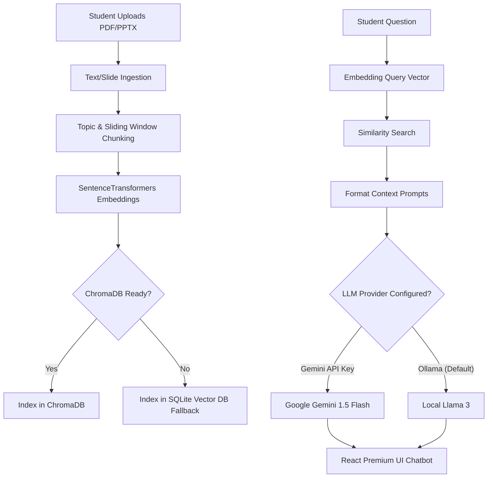

# 🎓 EduQuery AI - Educational RAG System

EduQuery AI is a state-of-the-art Retrieval-Augmented Generation (RAG) system tailored specifically for students. It allows students to upload their coursework (PDF textbooks, PowerPoint slides, notes) and interact with an intelligent tutor that answers queries **strictly** using the provided materials.

---

## 🌟 Key Features

- **Multi-Format Processing**: Full text, table, and speaker notes extraction for **PDFs** (via `PyMuPDF`) and **PPTX PowerPoint slides** (via `python-pptx`).
- **High-Fidelity UI**: Premium dark mode user experience with custom CSS glassmorphism, responsive file list, and click-action suggestion prompt chips.
- **Smart Chunking**: Topic-based slide chunking and sliding-window recursive character chunking with citation preservation.
- **Fail-Safe Adaptability**:
  - **Database Fail-Safe**: ChromaDB is the primary vector database. If ChromaDB fails to compile or install on Windows, the system automatically falls back to a custom, high-speed pure-Python SQLite database using float32 binary embeddings and NumPy.
  - **LLM Fail-Safe**: Runs locally offline using **Ollama (Llama 3)**. If Ollama is not active, setting a `GEMINI_API_KEY` in environment variables enables high-speed generation via Google Gemini API.

---

## 🏗️ Architecture Flow



---

## ⚙️ Setup & Installation

### 1. Prerequisites
- Python 3.10 - 3.13 installed.
- Node.js & npm installed (for React frontend).
- (Optional) [Ollama](https://ollama.com/) installed and running locally.
  - Ensure you pull the default model:
    ```bash
    ollama pull llama3
    ```

### 2. Installation Steps
1. Navigate into the project folder:
   ```bash
   cd educational-rag
   ```

2. Create a virtual environment and activate it:
   ```bash
   python -m venv venv
   # On Windows (PowerShell):
   .\venv\Scripts\Activate.ps1
   # On macOS/Linux:
   source venv/bin/activate
   ```

3. Install the dependencies:
   ```bash
   pip install -r requirements.txt
   ```

4. Install the React frontend dependencies:
   ```bash
   cd frontend
   npm install
   ```

---

## 🔑 Configuration (`.env`)

Create a `.env` file inside the `backend/` directory or at the project root to customize your configuration.

```ini
# Optional Cloud LLM Fallback (highly recommended if Ollama is not installed)
GEMINI_API_KEY=your-gemini-api-key-here
# Optional: defaults to a currently supported flash model
GEMINI_MODEL=gemini-3.1-flash-lite

# Ollama local configuration (Defaults)
OLLAMA_HOST=http://localhost:11434
OLLAMA_MODEL=llama3
```

---

## 🚀 Running the Application

To run the full stack, you will need to open **two terminal windows**:

### Terminal 1: Start the FastAPI Backend
```bash
# Run from the project root (the folder containing backend/ and frontend/)
.\venv\Scripts\Activate.ps1

# Start the uvicorn API server
python -m uvicorn backend.app:app --reload --port 8000
```
*The API will be available at `http://127.0.0.1:8000` with Swagger docs at `http://127.0.0.1:8000/docs`.*
*On startup, the backend indexes supported files already present in `backend/uploads` if they are missing from the vector database.*

### Terminal 2: Start the React Frontend
```bash
# From the project root:
cd frontend

# Start React Dev Server
npm run dev
```
*The browser will open the beautiful React dashboard at `http://localhost:5173`.*

---

## 🛠️ Verification & Testing

1. **Upload test files**: Drag and drop any syllabus, text file, PDF, or PowerPoint presentation in the sidebar.
2. **Interact**: Select one of the quick chips or ask a custom question (e.g., *"What is covered in slide 3?"* or *"List all main equations"*).
3. **Verify Citations**: Check the glowing cyan citation pills that appear at the bottom of the AI's responses, showing the exact source name, slide, or page number referenced.
